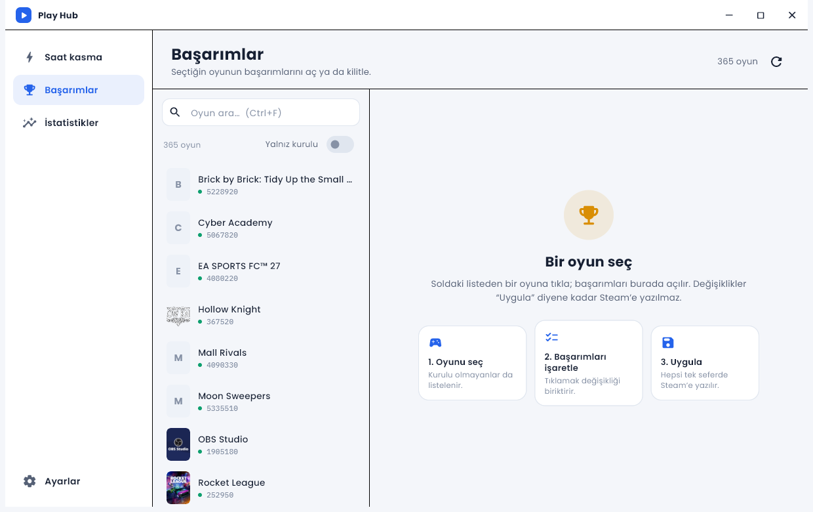
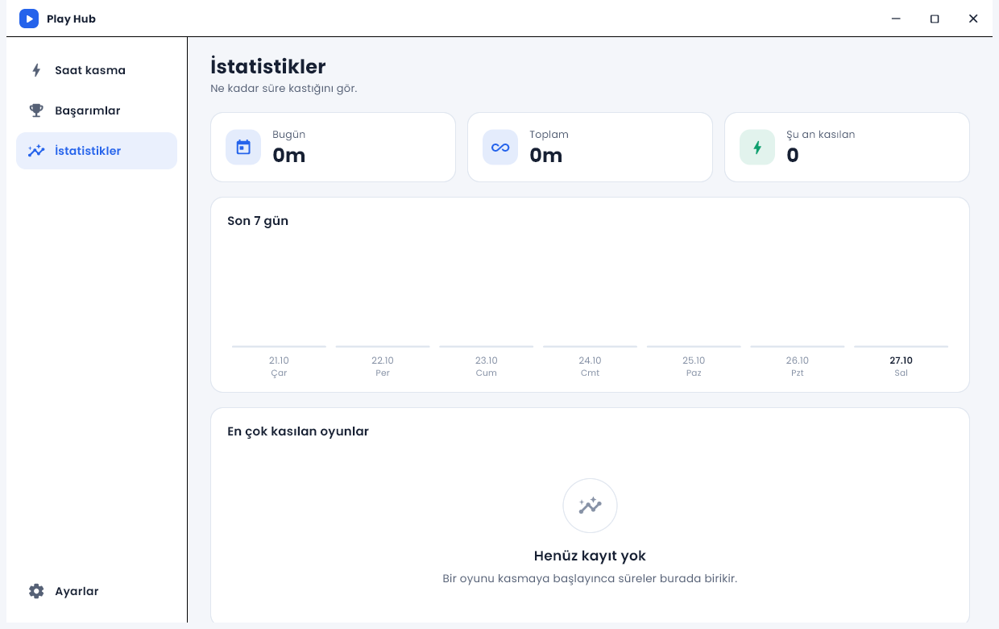
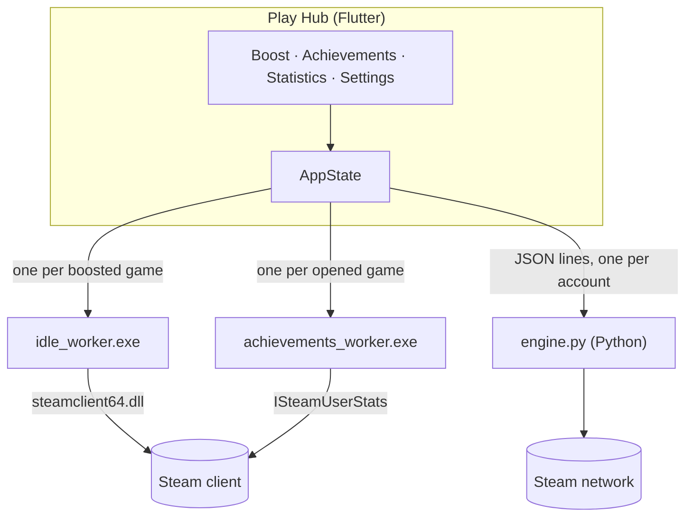

<div align="center">


# Play Hub

**One Steam toolbox in a clean, light window.** Boost playtime for this PC and for other accounts, manage achievements,
and see how many hours you have boosted — all in one app.


[Features](#-features) · [Install](#-install) · [Quick start](#-quick-start) · [How it works](#-how-it-works) · [Security](#-security--privacy) · [Build](#-build-from-source) · [Türkçe özet](#-türkçe-özet)



</div>

---

Play Hub replaces three earlier tools — **Idle Hub**, **Hour Booster** and **Trophy Room** — with a single app and one
consistent interface.

## ✨ Features

| Section | What it does |
|---|---|
| ⚡ **Boost hours** | Idle any game for the account signed in to Steam on **this PC** (no Python), or for **other accounts** through Steam's network with a QR code or username + password (+ Steam Guard). Up to 32 games per account, live timers, favorites, search, "Installed / Library / Favorites / Idling" tabs. |
| 🏆 **Achievements** | Instant, offline game list read from Steam's own cache. Unlock or lock achievements; changes are **queued** and written in one go with **Apply** (`Ctrl+S`). Search, locked-only, hidden filter, unlock / lock / invert visible. |
| 📈 **Statistics** | Today and all-time boosted hours, a 7-day chart and your most boosted games. |
| ⚙️ **Settings** | TR / EN, close-to-tray, launch with Windows, start minimized, optional Steam Web API key (full library), network engine status. |
| 🧭 **Tray-first** | Keeps boosting in the tray, resumes games and sessions after a restart. |

<div align="center">

</div>

## 📦 Install

**Installer (recommended).** Download `PlayHub-Setup-<version>.exe` from [Releases](../../releases) and run it. It installs
per-user (no admin rights), adds a Start-menu entry and an optional desktop shortcut.

> ☑ *Install Python 3.12 and the required packages to idle other accounts* — checked by default and only needed for the
> **other accounts** feature. **This PC** mode, **Achievements** and **Statistics** need no Python.
> The wizard also warns you if Steam is not installed.

Requirements: Windows 10 / 11 (64-bit) and the **Steam client running and signed in**.

## 🚀 Quick start

1. Start Steam and sign in, then open Play Hub.
2. **Boost hours** → pick *This PC* → press **Idle** next to a game. Close the window; it keeps running in the tray.
3. **Other accounts:** press **Add account**, sign in with QR or password. The session is remembered and resumes by itself.
4. **Achievements:** pick a game, click rows to mark what should be unlocked, press **Apply** (`Ctrl+S`).
   Close the game first — Steam may refuse writes while it runs.

| Shortcut | Action |
|---|---|
| `Ctrl+F` | Focus game search (Achievements) |
| `Ctrl+S` | Apply pending achievement changes |

## 🧠 How it works

Steam decides what you are "playing" by the processes that open a pipe to the Steam client with a given `SteamAppId`, and
`steamclient64.dll` locks onto the AppID of the **first** pipe in a process. So every game runs in its own tiny helper process:



`play_hub.exe`, `idle_worker.exe` and `achievements_worker.exe` must sit side by side (the installer and `tool\build.ps1` do this).

## 🔐 Security & privacy

* Passwords go only to Steam, are held in memory during sign-in and are **never written to disk**.
* Session keys and the optional Web API key are stored in **Windows Credential Manager** — not in a file, not in this repository.
* `state.json` (account names, favorites, boost history) lives in `%APPDATA%\dev.playhub\play_hub\PlayHub\` and contains **no secrets**.
* No telemetry, no analytics, no third-party servers — only Steam and Steam's image CDN.

> ⚠️ Not endorsed by Valve. Boosting playtime and changing achievements by hand may violate the Steam Subscriber Agreement or a
> game's rules, and achievements leave a **permanent trace on your Steam profile**. Use it only on accounts you own, at your own risk.

## 🔧 Build from source

Requirements: [Flutter](https://docs.flutter.dev/get-started/install/windows) (Windows desktop), Visual Studio **Desktop
development with C++**. Python 3.9+ only for *other accounts*.

```powershell
git clone https://github.com/GingerSugar06/PlayHub.git
cd PlayHub
flutter pub get
flutter test
powershell -File tool\build.ps1     # both workers + app + engine\ → build\windows\x64\runner\Release\
```

**Installer:** `tool\make_installer.ps1` (needs [Inno Setup 6](https://jrsoftware.org/isinfo.php); downloads the Python
installer to embed it). **Icon:** edit `assets/icon/app_icon.svg` or drop `assets/icon/source.png`, then `python tool/make_icon.py`.
**Preview a page:** `tool\shot.ps1 -Section stats` opens the built app on that page and captures only its own window.

### Project layout

```
PlayHub/
├─ lib/
│  ├─ main.dart            window, tray, single instance
│  ├─ ui/                  nav rail, boost page, statistics, dialogs, settings
│  ├─ achievements/        achievements page + state, library scan, worker bridge
│  ├─ state/               AppState: accounts, libraries, idling, session statistics
│  ├─ engine/              this-PC worker supervisor, remote account (Python engine)
│  ├─ steam/ data/ core/   library scan, storage, theme, TR/EN strings
├─ achievements_core/      steamclient FFI + schema parser + achievements_worker source
├─ worker/                 steam_worker: idle_worker source
├─ engine/                 engine.py (network engine for other accounts)
├─ installer/              Inno Setup script
└─ tool/                   build, installer, icon and screenshot helpers
```

## 🤝 Contributing

Issues and PRs are welcome. Please run `flutter analyze` and `flutter test`. **Never commit tokens, API keys or `state.json`.**

## 🇹🇷 Türkçe özet

**Play Hub**, Steam için tek pencerede üç araç sunar: **saat kasma** (bu bilgisayardaki hesap ve QR/şifreyle eklenen başka
hesaplar), **başarım yöneticisi** (değişiklikler biriktirilir, `Ctrl+S` ile Steam'e yazılır) ve **istatistikler** (bugün,
toplam, son 7 gün, en çok kasılan oyunlar). Arayüz açık renkli, Türkçe ve İngilizce. Şifren diske yazılmaz; oturum anahtarları
Windows Kimlik Bilgisi Yöneticisi'nde saklanır. Kurulum için [Releases](../../releases) sayfasındaki `PlayHub-Setup-*.exe`
dosyasını çalıştır; Python yalnızca başka hesap eklemek için gerekir. Başarımları elle değiştirmek profilinde kalıcı iz
bırakır ve Steam kurallarına aykırı olabilir; kendi hesabında, sorumluluğu sana ait olarak kullan.

## ⚖️ License & disclaimer

[MIT](LICENSE). Fonts: Poppins, IBM Plex Mono (SIL OFL 1.1). Unofficial project, **not affiliated with Valve**; "Steam" is a
trademark of Valve Corporation.
